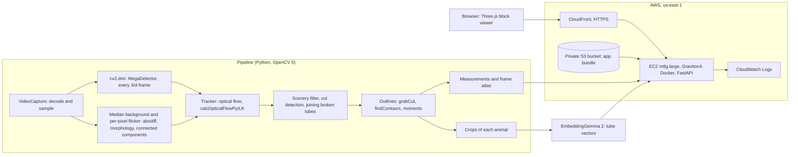

# Worldline

**See a whole camera-trap video at once.** Worldline turns a clip into a solid 3D block (picture width × height × time) and traces every animal visit through it as a coloured tube. You can see when something arrived, how long it stayed and where it went without watching the footage. You can search the tubes by typing a word ("badger", "bird on water") and upload your own clip.

**Live demo:** https://d3h0ll19w9xjtq.cloudfront.net · **Video (4 min):** https://youtu.be/UFovwwtCcCQ

Built for the OpenCV AI Competition 2026. OpenCV 5 does the computer vision; the app runs on AWS Graviton.

## What it does

- **Finds and follows animals.** MegaDetector (a camera-trap animal detector) runs through OpenCV 5's DNN module. Background subtraction and optical flow keep each animal followed between detections, and GrabCut traces its outline in every frame.
- **Measures each visit:** entry and exit time, dwell time, and distance moved. Visits are split correctly when a clip is several recordings joined together.
- **Shows the clip as a block** in the browser. Drag the "now" sheet through time, click a tube to jump to that animal, and turn the block with the mouse.
- **Searches by meaning.** Each tube is embedded with EmbeddingGemma 2 from OpenCV-cropped images of the animal. A result counts as *confident* only if the typed words fit the tube better than 26 other animal names, so "red fox" honestly reports no confident match where there is none.
- **Accepts your own clips** (up to 60 s and 50 MB). Each upload is processed privately and reachable only through its own link; the video is deleted once processed and its results after 24 hours.

## How it works



| Stage | OpenCV 5 |
|---|---|
| Decode and sample the clip | `VideoCapture` (FFmpeg), `resize` |
| Detect animals | `dnn.readNetFromONNX` (classic engine), `blobFromImage`, `NMSBoxes` |
| Find motion the detector missed | median background, `absdiff`, `morphologyEx`, `dilate`, `connectedComponentsWithStats`; a stricter per-pixel threshold where water or leaves flicker |
| Find joins between recordings | frame-difference statistics |
| Follow animals between detections | `goodFeaturesToTrack` and `calcOpticalFlowPyrLK` |
| Outline each animal per frame | `grabCut`, `findContours`, `moments` |
| Crops for search, the viewer's frame atlas, pixelating people in uploads | `resize`, `imencode`, `GaussianBlur` |

The detector and the search model are separate:

- **MegaDetector v5a** finds "animal / person / vehicle". It was converted to ONNX with [scripts/export_megadetector.sh](scripts/export_megadetector.sh) and is run by OpenCV.
- **EmbeddingGemma 2** (PyTorch) supplies the vocabulary for search.
- **YOLOX-S** is still available with `WORLDLINE_DETECTOR=yolox`, and is the fallback if the MegaDetector file is missing.

## Results so far

14 openly licensed clips with 21 animal visits, scored by [worldline/evaluate.py](worldline/evaluate.py) against labels in `eval/truth/`. **The labels are drafts still being checked by a person, and the thresholds were tuned on these same clips, so treat these as development numbers.**

**Held-out set:** 6 further clips, frozen before the pipeline ever saw them (commit `bd2cc97`), scored with `python -m worldline.evaluate --heldout`: 16 of 17 animal visits found, at least 62% of tubes are real animals, and the right species name comes first for 78% of tubes, in line with the development clips.

| | MegaDetector (default) | YOLOX-S |
|---|---|---|
| Animal visits found | 20 of 21 | 19 of 21 |
| Tubes that are real animals | 85% | 82% |
| Animal frames covered by a tube | 89% | 79% |
| Empty frames left empty | 54% (77% without one clip, see below) | 79% (70%) |

Search trial ([scripts/embed_trial.py](scripts/embed_trial.py)): the right species name comes first for 77% of 30 tubes, and typing a species brings up a tube of that species first in 8 of 9 searches. Cropping with the tube outline beats using the whole frame (77% against 70%).

Known failures:

- **A pale bush in an empty clip** (`cougar_call`) is detected as an animal for 15 s.
- **Red foxes at the frame's edge** aren't recognised by the search model.
- **Burnt-in captions** in an edited video create motion tubes.

## Run it locally

Requirements: Python 3.14 and about 3 GB of disk. [uv](https://docs.astral.sh/uv/) is needed for the MegaDetector conversion.

```bash
python3 -m venv .venv
.venv/bin/pip install -r requirements.txt
.venv/bin/python scripts/fetch_assets.py          # YOLOX model and the 14 clips (Wikimedia Commons)
scripts/export_megadetector.sh                    # converts MegaDetector v5a to models/md_v5a_640.onnx
.venv/bin/python -m worldline.pipeline clips/*.webm clips/*.ogv   # process the clips into web/data
.venv/bin/python -m worldline.server              # http://127.0.0.1:8765
```

The first server start downloads EmbeddingGemma 2 (about 1.5 GB) from Hugging Face. To edit the evaluation labels in the browser, use `python scripts/serve.py` and open `/label.html`.

## Evaluate and test

```bash
.venv/bin/python -m worldline.evaluate        # scores tubes against eval/truth, writes eval/results.json
.venv/bin/python scripts/embed_trial.py       # the species search trial, writes eval/embed_trial.json
.venv/bin/python -m pytest                    # 25 tests
```

The tests cover:

- each OpenCV stage on synthetic video: sampling, optical flow, foreground, cut detection, the scenery filter, joining tubes, pixelation;
- both detectors on a real frame;
- the scoring rules;
- the web API's refusals.

Tests that need the downloaded clips or models skip themselves if those files are missing.

## Deploy to AWS

```bash
deploy/deploy.sh                       # needs the AWS CLI signed in; us-east-1 by default
INSTANCE_TYPE=c8g.xlarge deploy/deploy.sh    # change the server size (restarts it)
```

The script bundles the code, processed clips and models, and uploads the bundle to a private, encrypted S3 bucket. It then creates or updates the CloudFormation stack in [deploy/worldline.yaml](deploy/worldline.yaml):

- **EC2 Graviton instance** running the server in Docker.
- **CloudFront** as the only way in (HTTPS). The security group admits only CloudFront's address range.
- **Instance role** limited to reading the bundle bucket and writing its log group.
- **CloudWatch Logs**, kept for 14 days.
- **No SSH:** administration is through SSM Session Manager.
- **Encrypted disk** and required metadata tokens (IMDSv2).

On later runs the script ships the new bundle to the running instance through SSM, and fails if the server's health check doesn't pass.

Cost: about $0.09 an hour for `m8g.large`, plus pennies for S3 and CloudFront. To remove everything:

```bash
aws cloudformation delete-stack --stack-name worldline
aws s3 rb s3://worldline-<account-id>-us-east-1 --force
```

## Responsible use

- **People are never tracked.** In uploaded clips, anything detected as a person is pixelated in the stored frames. The detector sometimes mistakes animals for people, so some wildlife is pixelated too; the upload panel says so. The curated clips contain no people and aren't pixelated.
- **Uploads:**
  - Visitors must confirm they have the right to share the footage.
  - Each clip is reachable only through its own unguessable link and is never listed.
  - The uploaded video is deleted as soon as it is processed; its results are deleted after 24 hours.
  - Limits: 60 s, 50 MB, 3 uploads per visitor per hour, 40 per day, one processed at a time.
- **Species names come only from what the crops show,** never from the detector's labels. The search marks weak matches as not confident.
- **Footage:** all 14 clips are from Wikimedia Commons under public-domain, CC BY or CC BY-SA licences; authors and links are in [clips/SOURCES.md](clips/SOURCES.md).

## Repository layout

```
worldline/       pipeline.py (OpenCV stages), detector.py, embed.py (search), evaluate.py,
                 server.py (FastAPI), uploads.py
web/             the viewer (index.html, app.js), label review page, bundled Three.js
scripts/         fetch_assets.py, export_megadetector.sh, embed_trial.py, serve.py, contact and label sheets
eval/truth/      per-clip labels (animal visits as timed points, with species)
deploy/          CloudFormation template and deploy script
tests/           pytest suite
```

## Licences and credits

| Component | Licence |
|---|---|
| MegaDetector ([agentmorris/MegaDetector](https://github.com/agentmorris/MegaDetector)) | Code MIT. Its authors describe GPL as the most restrictive licence among its usual runtime dependencies. Worldline runs it through OpenCV, using YOLOv5's AGPL export tool only to convert the weights at build time. |
| YOLOX-S (OpenCV model zoo) | Apache 2.0 |
| EmbeddingGemma 2 | Apache 2.0 |
| Three.js | MIT |
| Clips | As listed in [clips/SOURCES.md](clips/SOURCES.md) |
